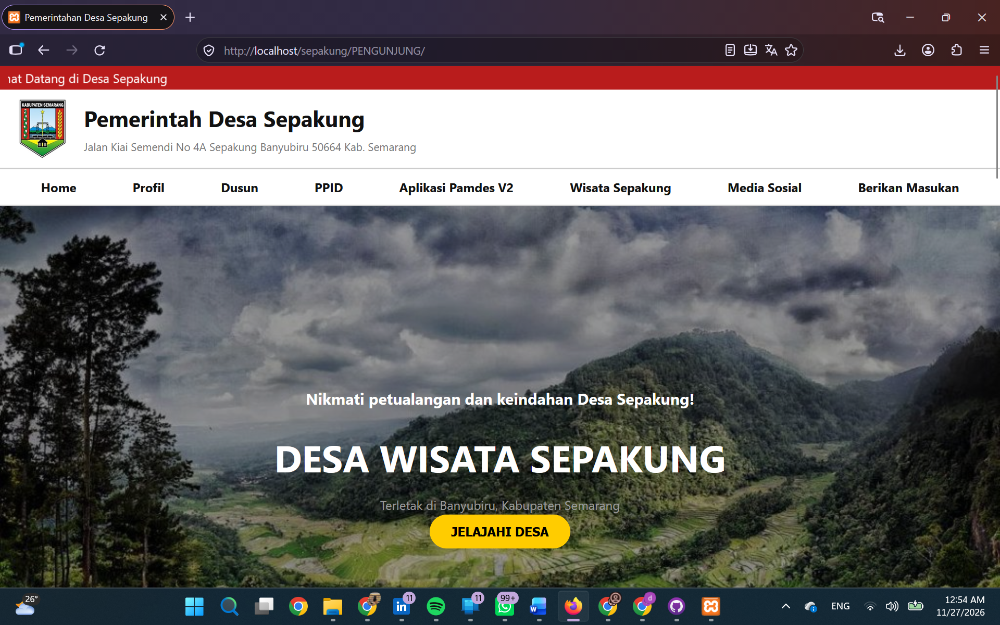
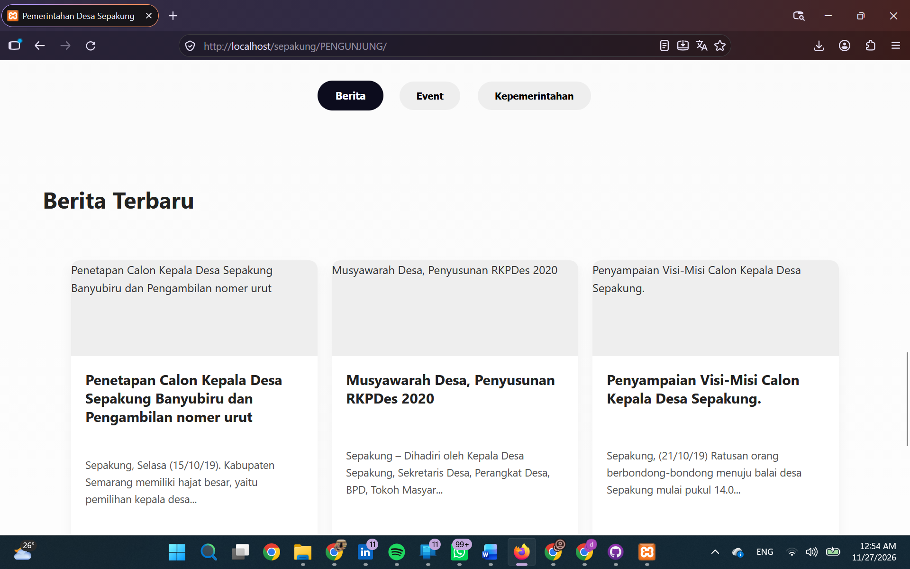
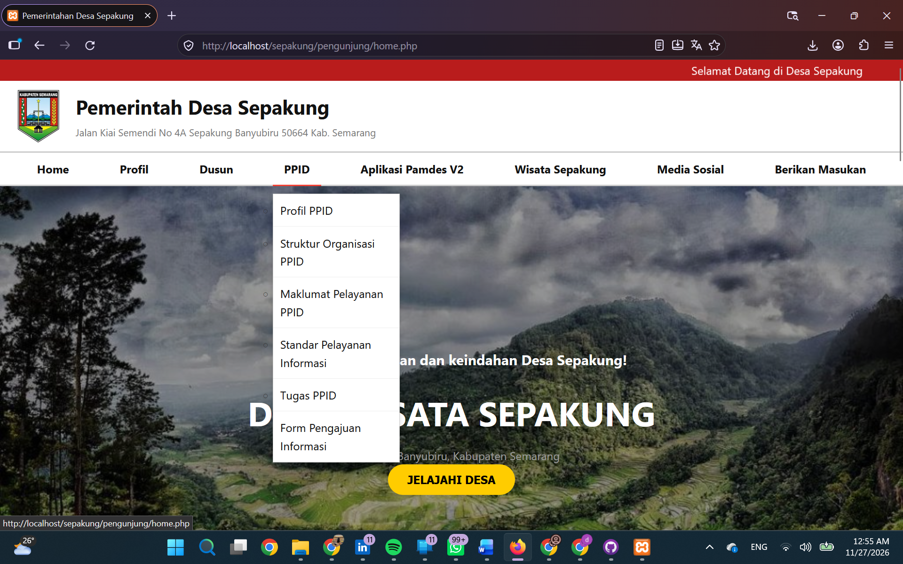
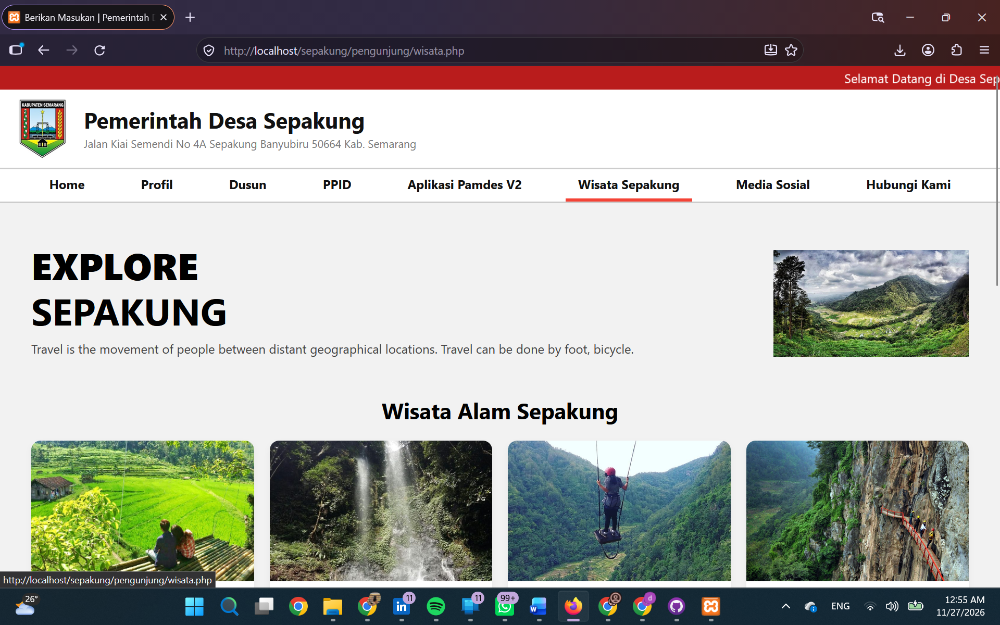
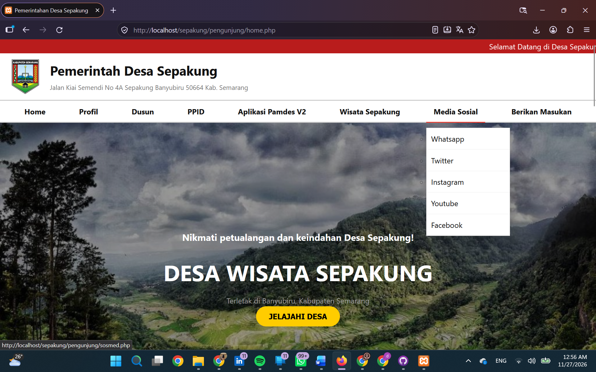
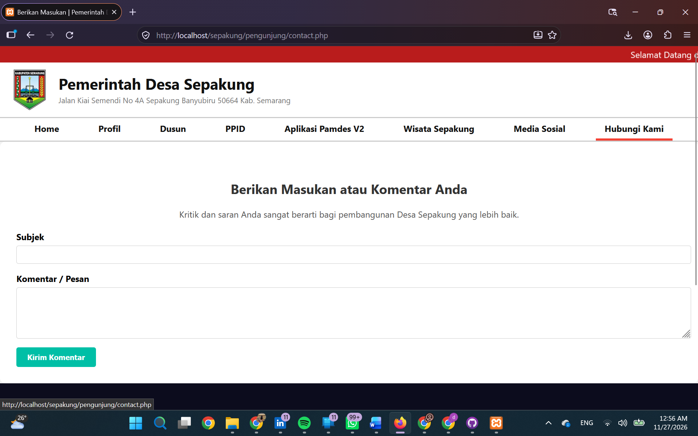

# WEBSITE SISTEM INFORMASI DESA SEPAKUNG



## 1. Deskripsi Proyek

Website Sistem Informasi Desa Sepakung merupakan platform informasi digital yang dikembangkan untuk menyediakan akses informasi mengenai pemerintahan, profil, wilayah, kependudukan, potensi, dan pelayanan publik Desa Sepakung, Kecamatan Banyubiru, Kabupaten Semarang.

Website ini dirancang sebagai sarana penyampaian informasi kepada masyarakat sekaligus media komunikasi antara pemerintah desa dan masyarakat. Melalui website ini, pengguna dapat mengakses berbagai informasi desa, mengenal potensi wisata, memperoleh informasi pelayanan publik, serta menyampaikan kritik dan saran.

## 2. Tujuan Pengembangan

Pengembangan website ini memiliki beberapa tujuan, yaitu:

- Menyediakan informasi mengenai profil dan kondisi Desa Sepakung.
- Mempermudah masyarakat dalam memperoleh informasi pemerintahan desa.
- Memperkenalkan potensi dan destinasi wisata Desa Sepakung.
- Menyediakan informasi mengenai pelayanan administrasi dan keterbukaan informasi publik.
- Menjadi media komunikasi antara pemerintah desa dan masyarakat.
- Mendukung penyebaran informasi desa melalui media digital.

## 3. Fitur Utama Website

### 3.1 Halaman Beranda (Home)

Halaman beranda merupakan halaman utama yang menampilkan identitas Pemerintah Desa Sepakung, alamat kantor desa, navigasi menu, serta banner utama yang memperkenalkan Desa Wisata Sepakung.

Fitur yang tersedia:
- Identitas Pemerintah Desa Sepakung.
- Navigasi menuju halaman website.
- Banner utama Desa Wisata Sepakung.
- Tombol Jelajahi Desa.

### 3.2 Halaman Jelajahi Desa

Halaman ini menyediakan akses menuju berbagai informasi dan layanan desa melalui beberapa kategori utama, yaitu:

- Dusun Desa Sepakung.
- PPID.
- Wisata.
- Kirim Komentar.

### 3.3 Halaman Profil Desa

Halaman profil menyediakan informasi mengenai kondisi dan karakteristik Desa Sepakung yang dikelompokkan menjadi beberapa kategori:

- Struktur Organisasi.
- Geografi.
- Kesehatan.
- Penduduk.
- Perekonomian.
- Potensi Desa.
- Sarana dan Prasarana (Sarpras).

### 3.4 Halaman Informasi Dusun

Halaman ini menyediakan navigasi informasi berdasarkan wilayah dusun yang berada di Desa Sepakung.

Daftar dusun yang ditampilkan meliputi:

1. Krajan.
2. Pagergedog.
3. Watulawang.
4. Gojati.
5. Bungkah.
6. Sepakung Wetan.
7. Batur.
8. Gowono.
9. Nglimut.
10. Kenongo.

### 3.5 Halaman PPID

Halaman Pejabat Pengelola Informasi dan Dokumentasi (PPID) menyediakan informasi mengenai pelayanan keterbukaan informasi publik di Desa Sepakung.

Menu yang tersedia:

- Profil PPID.
- Struktur Organisasi PPID.
- Maklumat Pelayanan PPID.
- Standar Pelayanan Informasi.
- Tugas PPID.
- Form Pengajuan Informasi.

### 3.6 Halaman Aplikasi Pamdes V2

Halaman ini menyediakan informasi dan panduan penggunaan aplikasi Pelayanan Administrasi Mandiri Desa Sepakung.

Informasi yang ditampilkan bertujuan membantu masyarakat memahami penggunaan aplikasi dan akses layanan administrasi desa melalui aplikasi maupun versi web.

### 3.7 Halaman Berita dan Informasi Desa

Halaman berita digunakan untuk menyampaikan informasi mengenai kegiatan, perkembangan, dan aktivitas Pemerintah Desa Sepakung.

Informasi dikelompokkan menjadi tiga kategori:

- Berita.
- Event.
- Kepemerintahan.

Berita ditampilkan dalam bentuk kartu informasi yang memuat judul, ringkasan, dan tombol untuk melihat detail berita.

### 3.8 Halaman Wisata Sepakung

Halaman wisata digunakan untuk memperkenalkan potensi pariwisata Desa Sepakung, khususnya wisata alam.

Halaman ini menampilkan gambar dan informasi destinasi wisata sebagai media promosi untuk memperkenalkan keindahan alam Desa Sepakung kepada masyarakat dan pengunjung.

### 3.9 Halaman Media Sosial

Website menyediakan akses menuju beberapa kanal media sosial Pemerintah Desa Sepakung, meliputi:

- WhatsApp.
- Twitter.
- Instagram.
- YouTube.
- Facebook.

### 3.10 Halaman Hubungi Kami

Halaman ini menyediakan formulir bagi masyarakat untuk menyampaikan kritik, saran, dan komentar kepada Pemerintah Desa Sepakung.

Formulir terdiri dari:
- Subjek.
- Komentar atau Pesan.
- Tombol Kirim Komentar.

Fitur ini diharapkan dapat menjadi sarana komunikasi dan masukan masyarakat untuk mendukung pengembangan desa.

## 4. Teknologi yang Digunakan

Teknologi yang digunakan dalam pengembangan website ini meliputi:

- **HTML**: Digunakan untuk menyusun struktur halaman website.
- **CSS**: Digunakan untuk mengatur tampilan, tata letak, dan desain antarmuka.
- **JavaScript**: Digunakan untuk mendukung interaksi dan fungsi pada halaman website.
- **PHP**: Digunakan untuk mendukung pengolahan halaman dan proses pada sisi server.

## 5. Struktur Proyek

Struktur direktori utama proyek Website Sistem Informasi Desa Sepakung adalah sebagai berikut:

```text
Website-Sistem-Informasi-Desa-Sepakung/
│
├── Dokumentasi/
│   ├── homepage.png
│   ├── jelajahi desa.png
│   ├── berita.png
│   ├── info desa.png
│   ├── profil desa.png
│   ├── info dusun.png
│   ├── ppid.png
│   ├── aplikasi pamdes.png
│   ├── wisata.png
│   ├── sosmed.png
│   └── masukan.png
│
├── FOTO/
│
├── PENGUNJUNG/
│
├── SEPAKUNG/
│
├── .gitattributes
├── .gitignore
└── README.md
```

Keterangan:

- **Dokumentasi**: Menyimpan tangkapan layar tampilan website.
- **FOTO**: Menyimpan aset foto yang digunakan dalam proyek.
- **PENGUNJUNG**: Berisi bagian website yang ditujukan untuk pengunjung.
- **SEPAKUNG**: Berisi direktori proyek terkait website Desa Sepakung.

## 6. Dokumentasi Tampilan Website

Berikut merupakan dokumentasi visual dari hasil pengembangan Website Sistem Informasi Desa Sepakung.

### 6.1 Halaman Beranda

Halaman utama yang menampilkan identitas Pemerintah Desa Sepakung dan banner Desa Wisata Sepakung.


### 6.2 Halaman Jelajahi Desa

Menampilkan akses menuju informasi dusun, PPID, wisata, dan formulir komentar.


### 6.3 Halaman Berita

Menampilkan informasi berita, event, dan kepemerintahan Desa Sepakung.



### 6.4 Informasi Desa

Menampilkan bagian informasi dan fasilitas yang tersedia pada website desa.


### 6.5 Halaman Profil Desa

Menampilkan kategori informasi profil dan kondisi Desa Sepakung.


### 6.6 Halaman Informasi Dusun

Menampilkan daftar dusun yang berada di wilayah Desa Sepakung.


### 6.7 Halaman PPID

Menampilkan menu pelayanan Pejabat Pengelola Informasi dan Dokumentasi.



### 6.8 Halaman Aplikasi Pamdes V2

Menampilkan panduan penggunaan aplikasi Pelayanan Administrasi Mandiri Desa Sepakung.


### 6.9 Halaman Wisata Sepakung

Menampilkan informasi dan visualisasi potensi wisata alam Desa Sepakung.



### 6.10 Halaman Media Sosial

Menampilkan pilihan kanal media sosial Pemerintah Desa Sepakung.



### 6.11 Halaman Hubungi Kami

Menampilkan formulir penyampaian kritik, saran, dan komentar masyarakat.



## 7. Cara Menjalankan Proyek

Untuk menjalankan website secara lokal, ikuti langkah-langkah berikut:

1. Unduh atau clone repository proyek dari GitHub.
2. Pastikan aplikasi XAMPP telah terinstal pada komputer.
3. Salin folder proyek ke dalam direktori `htdocs` pada XAMPP.
4. Jalankan Apache melalui XAMPP.
5. Jalankan MySQL apabila proyek membutuhkan koneksi basis data.
6. Buka browser.
7. Masukkan alamat berikut:

```text
http://localhost/sepakung/PENGUNJUNG/
```

8. Website dapat diakses melalui browser untuk melihat halaman dan fitur yang tersedia.

## 8. Manfaat Website

Pengembangan Website Sistem Informasi Desa Sepakung diharapkan memberikan beberapa manfaat, antara lain:

- **Bagi Masyarakat:** Mempermudah akses informasi mengenai desa dan pelayanan publik.
- **Bagi Pemerintah Desa:** Menjadi media penyampaian informasi dan publikasi kegiatan desa.
- **Bagi Pengunjung:** Memperoleh informasi mengenai potensi dan destinasi wisata Desa Sepakung.
- **Bagi Pengembangan Desa:** Mendukung pemanfaatan teknologi informasi dalam penyebaran informasi dan komunikasi publik.

## 9. Penutup

Website Sistem Informasi Desa Sepakung merupakan salah satu bentuk pemanfaatan teknologi informasi dalam mendukung penyampaian informasi dan pelayanan publik di lingkungan pemerintahan desa.

Melalui berbagai fitur yang tersedia, website ini diharapkan dapat meningkatkan kemudahan akses informasi, memperkenalkan potensi desa, serta mendukung komunikasi antara Pemerintah Desa Sepakung dan masyarakat.

---

**Project:** Website Sistem Informasi Desa Sepakung  
**Lokasi:** Desa Sepakung, Kecamatan Banyubiru, Kabupaten Semarang  
**Repository:** Website-Sistem-Informasi-Desa-Sepakung
